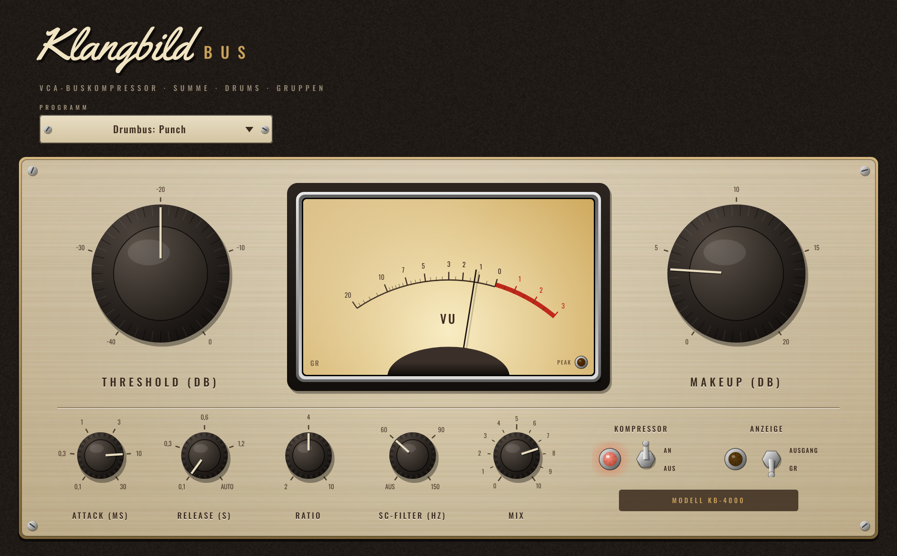

# Klangbild Bus

VCA-Buskompressor – inspiriert von den klassischen Buskompressoren großer Mischpulte. Hält Summe,
Drums oder Instrumentengruppen zusammen („Kleber“). Audio Unit für Logic Pro (außerdem VST3 und
Standalone), gebaut mit [JUCE](https://juce.com).



## Bedienung

| Regler | Wirkung |
|---|---|
| **Threshold** | Einsatzpunkt (−40 … 0 dBFS) |
| **Makeup** | Aufholverstärkung (0 … +20 dB) |
| **Ratio** | Stufen 2:1 · 4:1 · 10:1 |
| **Attack** | Stufen 0,1 · 0,3 · 1 · 3 · 10 · 30 ms – längere Zeiten lassen den Anschlag durch („Punch“) |
| **Release** | Stufen 0,1 · 0,3 · 0,6 · 1,2 s · **Auto**: nach kurzen Spitzen schnell (~0,1 s), nach anhaltender Kompression langsamer (~0,8 s) |
| **SC-Filter** | Hochpass im Regelweg (aus · 60 · 90 · 150 Hz): Bass und Kick lösen weniger aus, die Summe pumpt nicht |
| **Mix** | Parallelkompression („New York“) |
| **Kompressor An/Aus** | weicher Bypass zum Vergleichen |
| **Anzeige** | VU zeigt Pegelreduktion (GR) oder den Ausgang (0 VU = −18 dBFS) |

Beide Kanäle werden gemeinsam geregelt, das Stereobild bleibt stehen.

### Presets
Standard · Summe: Kleber · Drumbus: Punch · Drumbus: Parallel · Gitarren-Bus · Gesang-Bus · Bläser / Keys

### Typische Einstellung für die Summe
Ratio 2:1, Attack 30 ms, Release Auto, SC-Filter 90 Hz, Threshold so weit herunter, bis die Nadel bei
lauten Stellen 2–3 dB zurückgeht – dann mit Makeup den Pegel angleichen.

### Messwerte (Threshold −20 dBFS)
| Eingang | 2:1 | 4:1 | 10:1 |
|---|---|---|---|
| −10 dBFS | 5,0 dB GR | 7,5 dB GR | 9,0 dB GR |
| 0 dBFS | 10,0 dB GR | 15,0 dB GR | 18,0 dB GR |

Attack 3/10/30 ms gemessen: 2,7/10,7/32 ms · Release 0,1/0,3/0,6/1,2 s gemessen: 101/300/599/1195 ms.

## Installation in Logic Pro

Tab **Actions** → letzter grüner Lauf → **Artifacts** → `Klangbild-Bus-macOS`, dann:

1. `Klangbild-Bus-AU.zip` entpacken → `Klangbild Bus.component`
2. Finder → ⇧⌘G → `~/Library/Audio/Plug-Ins/Components` → Datei hineinkopieren
3. Einmal im Terminal:
   ```
   xattr -dr com.apple.quarantine ~/Library/Audio/Plug-Ins/Components/"Klangbild Bus.component"
   ```
4. Logic starten: **Audio Units → Klangbild → Klangbild Bus** – z. B. auf dem Stereo-Ausgang oder einem Bus

## Lizenzen

Schriften *Oswald* (OFL 1.1) und *Yellowtail* (Apache 2.0) – Lizenztexte in `Resources/`.
JUCE: AGPLv3 bzw. kommerziell – für den privaten Gebrauch unproblematisch.
